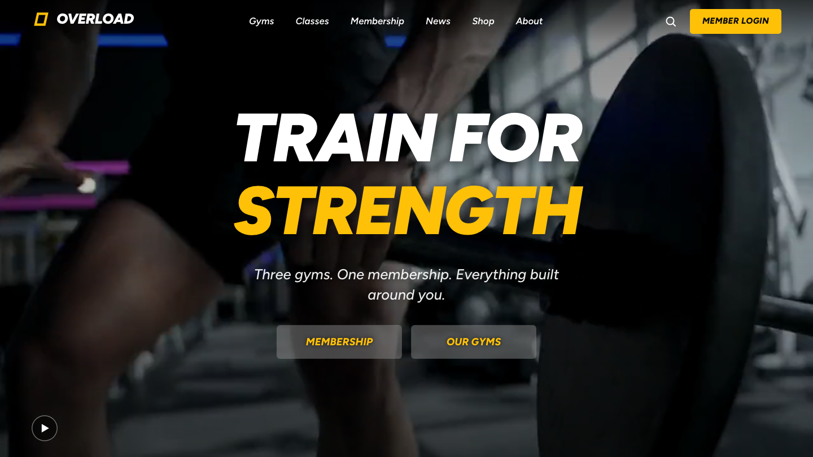
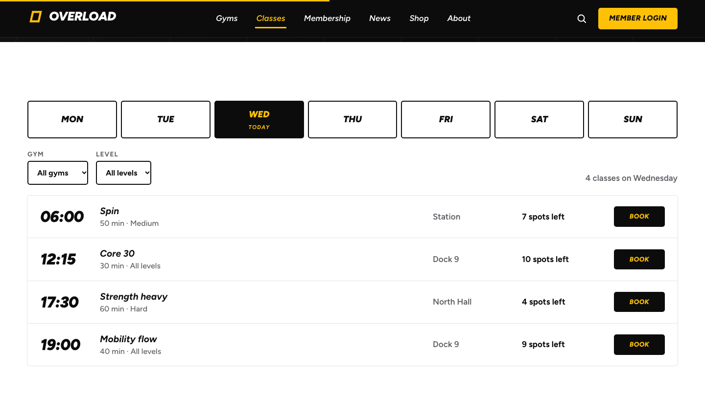
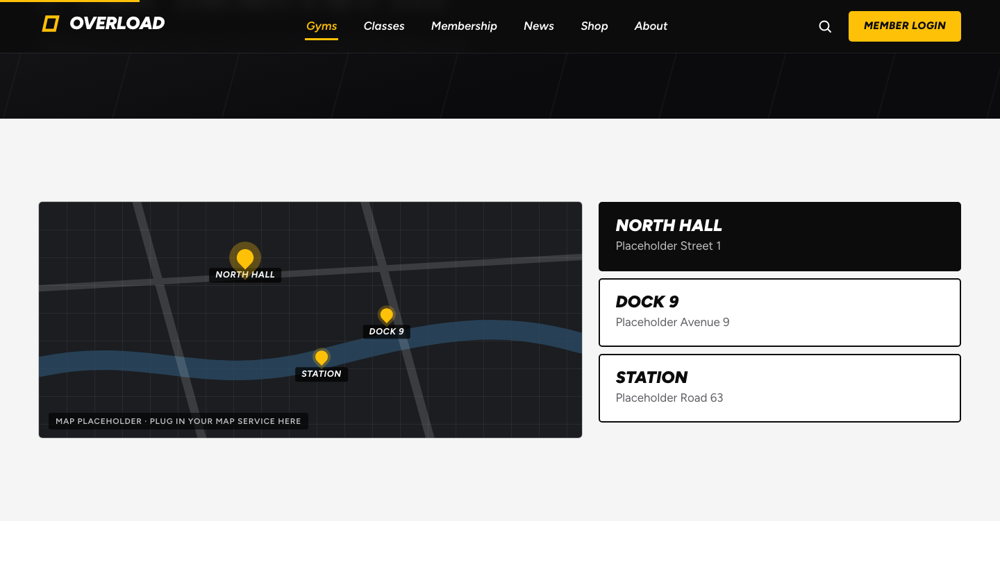
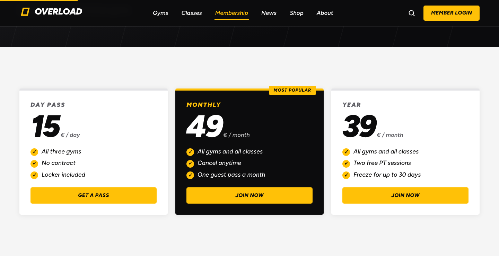

<div align="center">

# Overload

**A website template for a gym chain.**
Video hero, a class timetable you can filter and book, membership plans, news, shop and more, with all content in one file.

[**Live demo →**](https://jacobberggreen.github.io/overload-gym/)



</div>

## What it is

Overload is a made-up gym chain, built to show how a gym could present its gyms, classes and membership on one clear, fast website. Every name, price, time and text is placeholder content. Swap it for a real gym's content and the whole site follows.

It started as a web technology course project in 2024 and was rebuilt as a clean, reusable template: a new design, a single config file for all content, and no external UI libraries.

| Classes | Gyms | Membership |
| --- | --- | --- |
|  |  |  |

## Features

- **Video hero** with a rotating headline, glass buttons and a pause control. The video does not play for visitors who prefer reduced motion.
- **Class timetable**: pick a day, filter by gym and level, see spots left, book or join the wait list (demo).
- **Gyms** with a map placeholder, opening hours and facilities, and **membership** with plans, a comparison table and FAQ.
- **News and events**, a small **shop**, **about** and **contact** pages with a working form (demo).
- **Search** (press `/`) and a **member login** dialog, both built on the native `<dialog>` element.
- **Responsive** from phone to large desktop, with a full-screen menu on small screens.
- **Accessible by default**: semantic HTML, a skip link, visible focus, keyboard friendly, high-contrast text colours and `prefers-reduced-motion` respected.

## Motion and technique

No animation or UI libraries. The effects use what the browser already has:

- **Scroll-driven CSS animations** for the progress bar, the header that turns solid, and the hero that drifts and fades.
- **View Transitions** for page changes (a cross-fade), with a plain fallback where it is not supported.
- **IntersectionObserver** for content that comes in as it is scrolled to, and for numbers that count up.
- A tiny **hash router** (about 40 lines), so the built site works from any folder or static host, for example GitHub Pages.

Built with React 19 and Vite 8.

## Run it

```bash
npm install
npm run dev      # http://localhost:5173
npm run build    # static site in dist/
npm run preview  # try the build locally
```

## Make it yours

| What | Where |
| --- | --- |
| Text, numbers, gyms, timetable, plans, news, shop | [`src/site.config.js`](src/site.config.js) |
| Colours, sizes and spacing | the variables at the top of [`src/styles.css`](src/styles.css) (`--amber` is the accent colour) |
| Hero video and its poster image | `public/media/hero.mp4` and `hero-poster.jpg` |
| Photos | every gym, news item and product has a drawn placeholder; give it an `image` path in the config to show a real picture |
| Map | `MapPlaceholder` in [`src/ui.jsx`](src/ui.jsx) is a drawn stand-in; replace it with Leaflet, Mapbox or Google Maps |

Booking, the shop, the login and the contact form are **demos**: they show a message and send nothing. Connect them to your own systems.

### A note about the media

The hero video and the drawn photo placeholders are sample material for the demo. Replace the video with your own footage, or with a film you have the right to use, before you publish a real site.

## Project structure

```
src/
  site.config.js   all content
  main.jsx         app shell and routes
  pages.jsx        the pages
  Hero.jsx         the video hero
  Header.jsx       header, menu, search, login, footer
  ui.jsx           small shared pieces (links, reveal, counters, placeholders)
  router.js        hash router with view transitions
  styles.css       all styles
public/media/      hero video and poster
```

## Deploy

Pushing to `main` builds the site and publishes it to GitHub Pages (see [`.github/workflows/deploy.yml`](.github/workflows/deploy.yml)). The build uses relative paths, so it also works on any static host or in a subfolder.

## License

MIT © Jacob Berggren. See [LICENSE](LICENSE).
